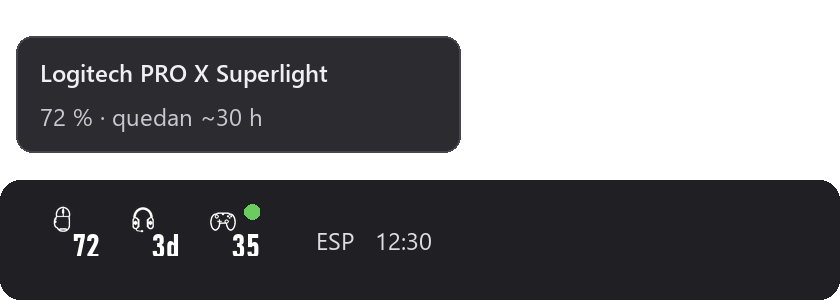
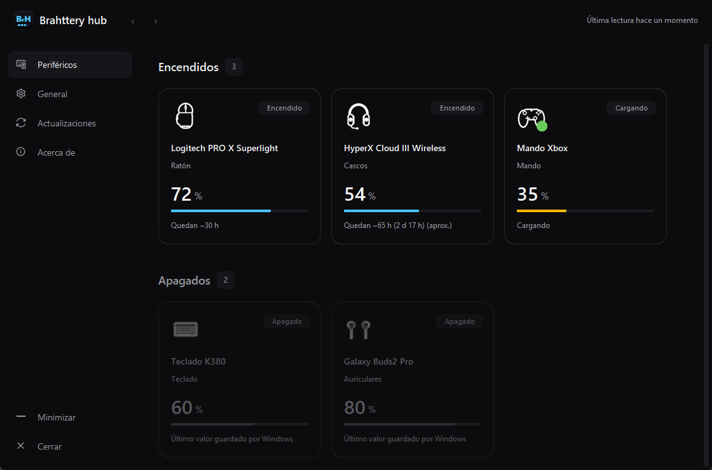
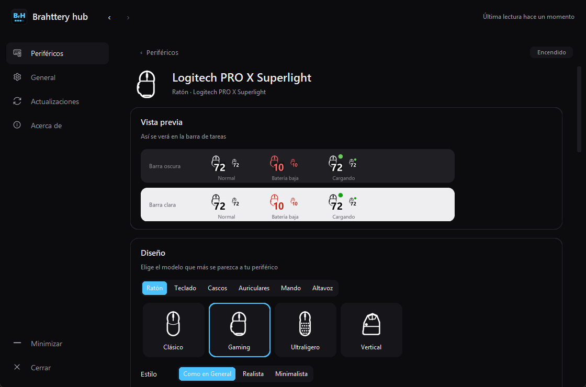
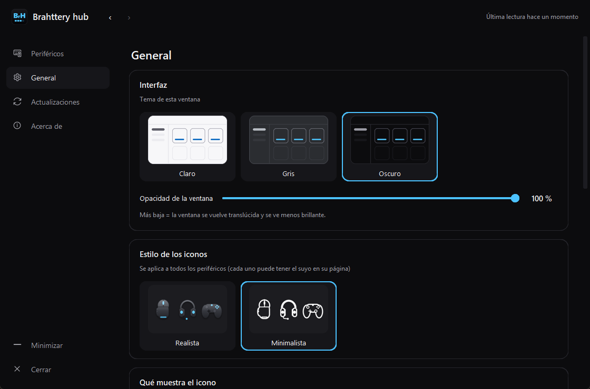
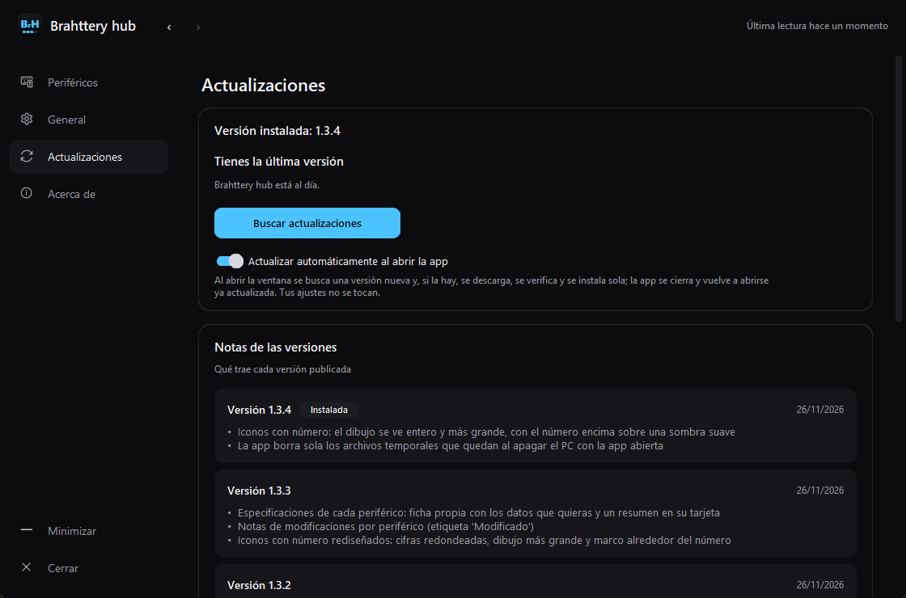
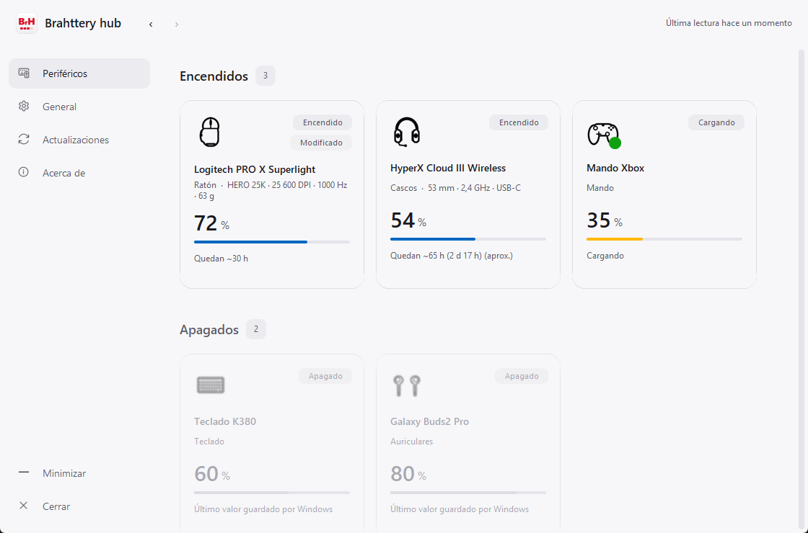

<p align="center">
  
</p>

<h1 align="center">Brahttery hub</h1>

<p align="center">
  La batería de tu ratón, cascos, mando y demás periféricos, siempre a la vista en la barra de tareas de Windows.
</p>

<p align="center">
  <a href="https://github.com/Brah912/brahttery-hub/releases/latest/download/Brahttery-hub-Setup.exe"><b>⬇ Descargar para Windows</b></a>
  &nbsp;·&nbsp;
  <a href="#instalación">Cómo instalarla</a>
  &nbsp;·&nbsp;
  <a href="#cómo-funciona-por-dentro">Cómo funciona</a>
  &nbsp;·&nbsp;
  <a href="#código-fuente">Código fuente</a>
  &nbsp;·&nbsp;
  <a href="https://github.com/Brah912/brahttery-hub/releases">Versiones</a>
</p>

<p align="center">
  
</p>

---

## Qué hace

- **Un icono por periférico** en la barra de tareas, junto al reloj. Al pasar el ratón por encima ves el **porcentaje** y las **horas de uso que quedan**.
- El icono puede mostrar **solo el dibujo**, el **porcentaje** o el **tiempo restante** (`45m`, `12h`, `3d`). Cambia de color cuando la batería está baja y muestra un punto verde mientras carga.
- **Tiempo restante real:** la app aprende cuánto gasta cada periférico *mientras lo usas* y recalcula su consumo una vez al día.
- **Ventana para personalizar** cada periférico: modelo (19 diseños de ratones, teclados, cascos, auriculares, mandos y altavoces), estilo realista o minimalista, colores, nombre, símbolo o imagen propia.
- **Ficha de especificaciones** de cada periférico (sensor, DPI, peso, drivers…) y **notas de modificaciones**, con un resumen en su tarjeta.
- Temas **Claro, Gris y Oscuro**, con opacidad ajustable.
- **Se actualiza sola** al abrirla y arranca con Windows en segundo plano.

<p align="center">
  
</p>

<details>
<summary><b>Más capturas</b></summary>
<br>

| Editor de un periférico | General |
|---|---|
|  |  |

| Actualizaciones | Tema claro |
|---|---|
|  |  |

</details>

---

## Instalación

**Requisitos:** Windows 10 u 11 de 64 bits. No hace falta instalar nada más (ni Python ni librerías) y **no pide permisos de administrador**.

1. Descarga **[Brahttery-hub-Setup.exe](https://github.com/Brah912/brahttery-hub/releases/latest/download/Brahttery-hub-Setup.exe)**. También está en la [página de versiones](https://github.com/Brah912/brahttery-hub/releases/latest), en *Assets*.
2. Ábrelo. Si aparece **"Windows protegió su PC"**, pulsa **Más información → Ejecutar de todas formas**. [¿Por qué aparece?](#por-qué-windows-avisa-al-instalarla)
3. Elige las opciones: acceso directo en el Escritorio y abrir al iniciar Windows (recomendado).
4. Pulsa **Instalar** y luego **Finalizar** con "Abrir Brahttery hub" marcado.

Listo: aparecen sus iconos junto al reloj y se abre la ventana.

### Uso diario

| Quiero… | Cómo |
|---|---|
| Ver la batería | Mira los iconos junto al reloj, o pasa el ratón por encima para ver el detalle |
| Abrir la ventana | **Un clic** en cualquiera de sus iconos, o el acceso directo |
| Cerrar la ventana sin cerrar la app | La **X**, o **Minimizar** en la barra lateral: sigue en segundo plano |
| Cerrar la app del todo | **Cerrar** en la barra lateral, o clic derecho en un icono → **Salir** |
| Cambiar los iconos | Pestaña **General** (todos) o clic en un periférico (solo ese) |

### Actualizar

No hay que hacer nada: al abrir la ventana, la app comprueba si hay una versión nueva. Si la hay, descarga el instalador, lo verifica y lo ejecuta en silencio: cierra la app, reemplaza sus archivos y la vuelve a abrir actualizada, en unos segundos. Tus ajustes no se tocan. Se puede desactivar en la pestaña **Actualizaciones**, donde además están las notas de cada versión.

### Desinstalar

**Configuración → Aplicaciones → Aplicaciones instaladas → Brahttery hub → Desinstalar.**
Al final te pregunta si quieres borrar también tus ajustes y el historial de batería.

<details>
<summary>¿La instalaste con una versión antigua (un <code>.zip</code> con <code>Instalar.bat</code>)?</summary>
<br>

Esas versiones no aparecen en Aplicaciones. Para quitarlas a mano:

1. Clic derecho en un icono de la app junto al reloj → **Salir**.
2. Pulsa `Win + R`, escribe `%LOCALAPPDATA%\Programs` y borra la carpeta **Brahttery hub**.
3. Borra el acceso directo **Brahttery hub** del Escritorio y del menú Inicio. Para el menú Inicio: `Win + R` → `%APPDATA%\Microsoft\Windows\Start Menu\Programs`.
4. En **Configuración → Aplicaciones → Inicio**, desactiva **Brahttery hub** si aparece.
5. Opcional, para borrar tus ajustes: `Win + R` → `%APPDATA%` y borra la carpeta **Brahttery hub**.

Más fácil: instala la versión nueva con el Setup **encima**. Reemplaza la vieja, conserva los ajustes y, desde ese momento, sí aparece en Aplicaciones.
</details>

---

## Periféricos compatibles

| Tipo | Ejemplos | Cómo se lee |
|---|---|---|
| **Bluetooth** (clásico y LE) | Auriculares, cascos, ratones, teclados, mandos, altavoces | La batería que el propio Windows ya conoce del dispositivo |
| **USB / receptores con el estándar HID de batería** | Periféricos de cualquier marca que lo implementen | Se pide a Windows el informe de batería del dispositivo |
| **Logitech** | Ratones, teclados y cascos con receptor Unifying, Bolt o Lightspeed, por cable o Bluetooth | Protocolo HID++ de Logitech, solo consultas de batería, nombre y tipo |
| **Mandos de Xbox** | Con adaptador inalámbrico o Bluetooth | API oficial de Windows (XInput) |
| **PlayStation 5** | Mando DualSense, USB o Bluetooth | Informe de estado que el mando envía |
| **HyperX** | Cloud III Wireless | Consulta de batería a su receptor USB |
| **SCYROX** | Ratones con receptor 8K o por cable | Consulta de batería a su receptor USB |

**Todavía no compatibles:** receptores con protocolo cerrado de Razer, Corsair o SteelSeries. Si tu periférico no aparece, abre un [issue](https://github.com/Brah912/brahttery-hub/issues) con su nombre.

> Algunos periféricos solo informan la batería de 5 en 5 % o por niveles (por ejemplo los mandos de Xbox: vacío, bajo, medio, lleno). La app muestra exactamente lo que el dispositivo informa: no inventa decimales.

---

## Cómo funciona por dentro

Esta sección explica todo lo que la app hace en tu PC, para que sepas exactamente qué instalas.

### Lectura de la batería

- Cada **60 segundos** la app pregunta la batería a los periféricos conectados, por las vías de la tabla de arriba. Cada lectura completa tarda unos 60 ms.
- **Todo es de solo lectura:** no cambia ningún ajuste de tus periféricos (DPI, luces, perfiles…), no instala controladores ni servicios, y no necesita permisos de administrador.
- Si un ratón entra en **reposo** para ahorrar batería pero su receptor sigue enchufado, se muestra con su último valor, marcado como *"En reposo"*.

### Cálculo del tiempo restante

1. Solo cuenta como **tiempo de uso** el que el periférico está encendido y respondiendo. Las horas con el periférico apagado o dormido, o con el PC apagado, no cuentan, porque no gastan batería.
2. Cada descarga, de una carga a la siguiente, se guarda por separado durante **30 días**.
3. **Una vez al día**, en segundo plano (tarda alrededor de 1 milisegundo), calcula el **% por hora de uso** de cada periférico. Pondera por horas de uso y da más peso a las descargas recientes.
4. **Tiempo restante = batería actual ÷ consumo medido.** Mientras todavía no hay datos suficientes, usa la autonomía típica del tipo de periférico y lo indica con *"(aprox.)"*. Esa autonomía la puedes cambiar en el editor de cada periférico.

En el editor de cada periférico, en *Uso*, se ve en qué se basa el cálculo. Por ejemplo: *"Consumo medido: 2,4 % por hora de uso, con 41 h registradas en 3 descargas"*.

### Conexiones a internet

La app **solo** se conecta a GitHub, y **solo** para buscar actualizaciones:

| Cuándo | Qué descarga |
|---|---|
| Al abrir la ventana (y al volver a mostrarla si pasó más de 1 hora) | `brahttery-hub.json` de la última versión publicada: número de versión, notas y huella |
| La bandeja, cada 6 horas | El mismo archivo, para avisarte con una notificación |
| Solo si hay versión nueva | El instalador `Brahttery-hub-Setup.exe` y su huella `.sha256` |

- **No envía nada sobre ti ni sobre tus periféricos.** No hay cuentas, analíticas ni telemetría. Las peticiones son descargas normales de archivos públicos.
- La versión nueva se **verifica con SHA-256** antes de instalarse. Si la huella no coincide, se descarta.
- Para comprobarlo tú mismo, usa la guía de [verificación de la descarga](#verificar-la-descarga).

### Archivos que guarda

Todo en `%APPDATA%\Brahttery hub`:

| Archivo | Contenido |
|---|---|
| `config.json` | Tus ajustes: tema, colores, nombres, iconos |
| `estado.json` | Últimos periféricos vistos y su batería, para mostrarlos en la ventana |
| `historial.json` | Niveles de batería con fecha y tiempo de uso (últimos 30 días), para calcular el consumo |
| `brahttery_hub.log` | Registro de lecturas y errores, útil si algo falla |

El programa se instala en `%LOCALAPPDATA%\Programs\Brahttery hub`: el `.exe` y una carpeta `_internal` con Python y sus librerías.

### Cambios en Windows

Todos son del **usuario actual** (`HKEY_CURRENT_USER`) y se pueden deshacer:

| Qué | Dónde | Para qué |
|---|---|---|
| Arranque con Windows | `…\CurrentVersion\Run` → `BrahtteryHub` | Abrir la app, solo la bandeja, al encender el PC. Se activa la primera vez; si lo desactivas, se respeta |
| Iconos visibles | `Control Panel\NotifyIconSettings` → `IsPromoted` de **sus propios** iconos | Que aparezcan en la barra y no escondidos en la flecha ^. Una sola vez por icono, solo Windows 11 |
| Preferencias propias | `Software\BrahtteryHub` | Recordar que ya hizo lo anterior, para no repetirlo |
| Aplicaciones instaladas | `…\Uninstall\{B19F4761-…}_is1` | Que aparezca en Configuración → Aplicaciones (lo crea el instalador) |

Al desinstalar se quitan el arranque, las preferencias propias y la entrada de Aplicaciones. La lista de iconos de la bandeja la administra Windows, que descarta los de programas que ya no existen.

## Código fuente

Todo el código de la app está en este repositorio, para que puedas revisar lo que hace.

| Archivo | Qué hace |
|---|---|
| `Brahttery hub.pyw` | Punto de entrada: abre la bandeja, o la ventana con `--configurar` |
| `bandeja.py` | Iconos de la bandeja, menú, lectura cada minuto y aviso de actualizaciones |
| `ventana.py` | Ventana de personalización (customtkinter) |
| `dispositivos.py` | Lectores de batería: Bluetooth, HID estándar, Logitech HID++, XInput, HyperX, SCYROX, DualSense |
| `hid_estandar.py` | Lectura del estándar HID de batería (solo lectura, mediante la API de Windows) |
| `estimacion.py` | Cálculo del tiempo restante con el consumo real |
| `apariencia.py`, `modelos.py`, `selector_color.py` | Dibujo de los iconos, los 19 modelos de periféricos y el selector de color |
| `actualizador.py` | Busca, descarga, verifica (SHA-256) e instala las actualizaciones |
| `diagnostico.py` | Informe de diagnóstico |
| `rutas.py` | Versión, carpetas de datos e inicio con Windows |
| `compilar.ps1`, `instalador.iss`, `publicar.ps1` | Compilar con PyInstaller, crear el instalador (Inno Setup) y publicar una versión |

### Compilarla tú mismo

Necesitas Windows 10/11, [Python 3.12 o más nuevo](https://www.python.org/downloads/) e [Inno Setup 6](https://jrsoftware.org/isinfo.php) (solo para el instalador).

```powershell
py -m pip install -r requirements.txt pyinstaller
py "Brahttery hub.pyw"                                      # probarla sin compilar
powershell -ExecutionPolicy Bypass -File .\compilar.ps1    # crea dist\Brahttery hub\
```

---

## Preguntas frecuentes

### Por qué Windows avisa al instalarla

Windows muestra *"Windows protegió su PC"* con cualquier programa que no tenga una **firma digital de pago** y que todavía haya sido descargado por poca gente. Brahttery hub es un proyecto personal sin firma, por eso aparece el aviso. Pulsa **Más información → Ejecutar de todas formas**.

Algunos antivirus desconfían de los programas hechos con Python y empaquetados con PyInstaller. Es un falso positivo conocido. Si te pasa, restáuralo desde la cuarentena y agrega la carpeta `%LOCALAPPDATA%\Programs\Brahttery hub` como excepción.

### Verificar la descarga

Cada versión publica la huella SHA-256 del programa. Para comprobar que tu copia es la original, abre PowerShell y escribe:

```powershell
Get-FileHash "$env:USERPROFILE\Downloads\Brahttery-hub-Setup.exe"
```

El resultado tiene que ser igual al de `Brahttery-hub-Setup.exe.sha256` de esa [versión](https://github.com/Brah912/brahttery-hub/releases), y al que aparece al final de sus notas.

### Mi periférico no aparece

- Comprueba que esté encendido y conectado: el receptor enchufado, o emparejado por Bluetooth.
- Algunos periféricos solo informan su batería por su propio programa (Razer Synapse, Corsair iCUE…); esos todavía no se pueden leer.
- Si nada de eso es el problema, abre un [issue](https://github.com/Brah912/brahttery-hub/issues) con el nombre del periférico y adjunta `%APPDATA%\Brahttery hub\brahttery_hub.log`.

### ¿Consume muchos recursos?

No. Hace una lectura por minuto (unos 60 ms), un cálculo al día de alrededor de 1 ms, y guarda unos pocos KB.

- **Con la ventana cerrada** solo queda la bandeja: unos **40 MB de RAM**.
- **Con la ventana abierta:** unos **115 MB**. Si la dejas oculta, a los 10 minutos se cierra sola para liberar esa memoria (se puede desactivar en *General*). El siguiente clic en un icono la vuelve a abrir en un par de segundos.

---

<p align="center"><sub>Hecho por <a href="https://github.com/Brah912">Brah912</a> · <a href="https://github.com/Brah912/brahttery-hub/releases">Historial de versiones</a></sub></p>
